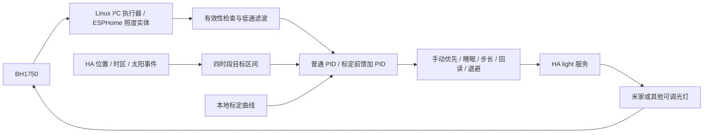

# LumaLoop HA · 恒照度平滑调光

[English](README.md) · [标定说明](docs/calibration.md) · [技术架构](docs/architecture.md)

基于 Home Assistant、BH1750 照度反馈和 PID 的自动调光集成。支持已接入 HA 的米家 / 小米可调光灯具，以及其他提供亮度反馈的 HA 灯具。用户可以在自己的空间测量亮度—照度曲线，使用“标定前馈 + PID 纠偏”控制。

## 实现目标

- 以传感器测量位置为准，将照度维持在用户设置的上下限区间，而非不停追逐单个数值。
- 根据 HA 中配置的位置、时区和日出日落，区分日出、白天、日落、黑夜四个时段。
- 使用低通滤波、亮度步长限制、积分抗饱和与回读保护，减少跳变和命令堆积。
- 手动操作优先；可选睡眠时段与结束唤醒；自然光足够时可在最低亮度附近尝试关灯，仅重新打开由控制器自己关掉的灯。
- 默认仅观察、PID 关闭；重启后需要重新启用 PID。标定数据由用户自行生成，保存在本地。

当前版本每个 HA 实例仅支持 **一盏目标灯 + 一个传感器**。灯组需要可靠的整体亮度回读，并以整个灯组为对象重新标定。本项目不负责米家设备配网，也不会绕过原有接入集成；传感器不在工作面时，不能据此保证工作面照度。

## 所需硬件

| 硬件 | 要求 |
| --- | --- |
| Home Assistant 主机 | 支持自定义集成；固定回归基线为 HA 2026.2.3 / Python 3.13 |
| BH1750 模块 | 如 GY-302，I²C 地址通常为 `0x23`，也可为 `0x5c` |
| 灯具 | 已通过适用的米家 / 小米集成接入 HA，存在可调光 `light.*` 实体，能反馈 `brightness` |
| 传感器主控 | ESP32 开发板，或能够访问 `/dev/i2c-1` 的 Linux 树莓派 |
| 接线 | 四根杜邦线，必要时增加 ADDR 接线 |

控制器使用 HA 灯具服务；灯具是否依赖云端取决于原有接入集成。延迟较高时应增大调节间隔。

## 接线步骤

先断电，再接线。按模块丝印核对引脚，统一使用 3.3 V 供电和逻辑电平。BH1750 只连接低压主控，不接入灯具市电线路。

| BH1750 | 树莓派 40 针排针（物理脚号） | 经典 ESP32 开发板 |
| --- | --- | --- |
| VCC / VIN | 1 脚，3V3 | 3V3 |
| GND | 6 脚，GND | GND |
| SDA | 3 脚，GPIO2 / SDA1 | GPIO21 |
| SCL | 5 脚，GPIO3 / SCL1 | GPIO22 |
| ADDR | 接地或模块默认低电平，地址 `0x23` | 接地或模块默认低电平，地址 `0x23` |

ADDR 高电平为 `0x5c`，需同步修改配置。ESP32-S3/C3 等板卡引脚不同，不能直接照搬 GPIO21/22。I²C 线尽量短。传感器固定在需要控制照度的位置，同时接受目标灯光和自然光，避免人体遮挡；移动后重新标定。

## 部署方案 A：ESPHome，适用于 HA OS / 虚拟机 / 通用主机

1. 按表连接 ESP32 和 BH1750。在 ESPHome 中使用 [传感器配置](examples/esphome-bh1750.yaml)，在自己的 `secrets.yaml` 填入 `wifi_ssid`、`wifi_password`、`api_encryption_key`、`ota_password`，通过 ESPHome 生成加密密钥。编译烧录后，将设备添加到 HA 的 ESPHome 集成。
2. 确认照度实体以 `lx` 为单位，每秒报告一次。示例设置 `force_update: true`，照度不变时也会报告，避免被判断为失联。
3. 下载本仓库，将 `custom_components/lighting_smooth` 整个文件夹复制到 HA 的 `/config/custom_components/lighting_smooth`。保留原集成域名是为了兼容旧实体，不要再复制一份并随意改目录名。
4. 将 [configuration.yaml 示例](examples/configuration.yaml) 合并进 HA 配置，用开发者工具 → 状态中实际存在的 ID 替换两个 `example` 实体。不要配置两个重复的 `lighting_smooth:` 根节点。
5. 在 HA 中检查配置，再重启。确认生成照度、参数、开关等实体，以及 `lighting_smooth.start_calibration` 操作。
6. 新建仪表盘，将 [dashboard.yaml](examples/dashboard.yaml) 粘贴到原始配置编辑器，或者手动添加实体。

## 部署方案 B：树莓派 Linux 直接读取 I²C

在 Raspberry Pi OS 执行 `sudo raspi-config`，通过 Interface Options → I2C 开启接口，必要时重启。确认存在 `/dev/i2c-1`，HA 运行用户具有设备读写权限。HA Container 需要设备映射，参见 [compose.yaml](examples/compose.yaml)；`config` 目录位于 compose 文件旁，先把集成和 HA 配置放进去。示例使用 Linux 主机网络，HA 仍需完成常规初始化。

使用配置文件中被注释的 **直接 I²C 方案**，移除 `illuminance_entity`，保留 `bus: 1`、`address: 0x23`。无需额外安装 Python I²C 库，阻塞读取在执行器中运行。此方案依赖 Linux `fcntl`，不能在 Windows HA 主机直接运行。HA OS 启用 I²C 的方式与 Raspberry Pi OS 不同，应参照官方 HA OS 文档；一般用户可优先选择方案 A。

## 首次使用

1. 在 HA 中配置自己的家庭位置和时区，确认灯具调光和亮度反馈正常，关闭其他冲突的灯光自动化。
2. 保持 `switch.lighting_smooth_observe` 开启。手动开灯后启用 `switch.lighting_smooth_enabled`，观察计算结果；观察模式不会发送 PID 调灯命令。
3. 按实际需求调整 `number.lighting_smooth_day_lux_min` / `..._max`，以及 `sunrise`、`sunset`、`night` 对应参数。修改时保证下限始终小于上限，避免中间值无效。
4. 按 [标定文档](docs/calibration.md) 建立自己的曲线，成功后打开 `switch.lighting_smooth_calibration_enabled`。不标定也可运行普通 PID。
5. 关闭“仅观察”，再重新启用 PID。切换观察模式会停止控制，需要明确重新开启。建议从默认 10 秒周期、单次最大 3 个百分点开始，观察响应后再调参。

采样与调度为每秒一次，实际发令取决于调节周期、误差、亮度量化和回读确认，不等于每秒发命令。运行界面保留中文实体名称和多数中文状态消息，实体 ID 固定。

## 技术架构与控制策略



纯算法在 `engine.py`；HA 生命周期、时段与保护逻辑在 `__init__.py`；`calibration_runner.py` 测量曲线，`calibration.py` 做条件匹配与分段线性正反查表。六类原生 HA 平台提供传感器、数值、开关、选择、按钮、时间控件。详细公式及文件职责见 [架构说明](docs/architecture.md)。

## 行为边界与故障处理

- 传感器失联、数值无效或饱和时暂停 PID。实体输入必须以 lux 为单位、20 秒内有新报告，且低于 `54612 lx`；直连 BH1750 的原始值 `65535` 为饱和。
- 灯具回读超时会退避，连续失败会停止自动调光。HA 状态反馈不等于物理光输出已经到位。
- 手动调灯后默认暂停 120 秒；手动关灯后保持关闭。自然光控制只重新打开由自己关闭的灯，不能任意打开其他关闭状态的灯。
- 睡眠开关独立于 PID / 观察开关，启用后每个时段尝试关灯一次；睡眠中手动重新开灯会保留。结束唤醒是额外选项，启用后可开灯并进入实控。两者默认关闭，标定前需关闭。
- 标定会开关灯并逐档升到 100%；结束、失败、取消时尝试恢复原开关状态和亮度。断电、进程被杀或设备离线时无法保证恢复，需人工检查。标定后 PID 保持关闭。
- 只保留一条本地曲线；更换灯具、传感器位置、家具布局、固定色温或场景后应重新标定。标定不支持 RGB/HS 场景及动态特效。
- 当前没有图形化配置向导，也未上架 HACS；安装方式为目录复制和 YAML 配置。不同房间不共享实测曲线，不承诺同一组参数适用于所有灯具。

## 脱敏与验证

发布目录仅包含源代码、示例、测试和文档。没有携带原始部署脚本、运行日志、家庭截图、备份、灯具清单、实测曲线、HA 令牌、Wi-Fi 密码、SSH 地址、家人姓名或家庭经纬度。公开 GitHub 用户名仅作为发布者仓库地址及原有 MIT 版权署名出现。

用户标定数据及灯具实体 ID 仅保存在自己 HA 的 `.storage/lighting_smooth*` 中，不随软件上传。本集成不发送遥测；报错时请勿上传 `.storage`、`secrets.yaml` 或家庭日志原件。

```sh
python -m pip install -r requirements-test.txt
python -m unittest discover -s tests -v
python tools/check_public_tree.py
```

测试使用合成光学数据和模拟服务，不控制真实灯具。覆盖范围与限制见 [验证记录](docs/validation.md)。项目采用 [MIT 许可证](LICENSE)。

## 官方参考

- [Home Assistant YAML 集成加载](https://contributors.home-assistant.io/core/integrations/yaml/)
- [HA OS 树莓派 I²C](https://contributors.home-assistant.io/os/operating-system/raspberry-pi/)
- [ESPHome BH1750](https://esphome.io/components/sensor/bh1750/)
- [Adafruit BH1750 接线](https://learn.adafruit.com/adafruit-bh1750-ambient-light-sensor/python-circuitpython)
