# Architecture / 技术架构

## Data flow / 数据流

```mermaid
flowchart TD
  A[BH1750] --> B[Linux executor or ESPHome entity]
  B --> C[Freshness / range / saturation checks]
  C --> D[Low-pass total lux]
  SUN[HA location and local solar times] --> TARGET[Phase-specific lux band]
  D --> PID[Bounded PID]
  TARGET --> PID
  MODEL[Local monotone calibration] --> FF[Inverse-curve feedforward]
  D --> FF
  FF --> PID
  PID --> GUARD[Manual pause / sleep / output bounds / cadence]
  GUARD --> SERVICE[HA light service]
  SERVICE --> LAMP[Dimmable lamp]
  LAMP --> A
  LAMP --> ACK[HA brightness readback / backoff]
  ACK --> GUARD
```



| Module | English | 中文 |
| --- | --- | --- |
| `__init__.py` | YAML schema, lifecycle, serialized controller, sun/sleep, service/readback guards, calibration orchestration | 配置校验、生命周期、控制互斥、太阳 / 睡眠时段、命令及标定编排 |
| `engine.py` | Pure PID, lux filtering, phase selection and bounded feedforward correction | 无硬件依赖的 PID、滤波、时段与受限前馈纠偏 |
| `bh1750_io.py` | One-shot Linux I²C read in HA executor | 执行器中的 Linux I²C 单次读取 |
| `calibration_runner.py` | Asynchronous sweep, quality checks, finally-based restoration | 异步标定扫描、质量检查与 finally 恢复 |
| `calibration.py` | Monotone validation, linear forward/inverse lookup, applicability | 单调曲线校验、线性正反查表及条件匹配 |
| `sleep_schedule.py` | Local-time, cross-midnight window calculation | 本地时间与跨午夜睡眠窗口 |
| `sensor/number/switch/select/button/time.py` | Native HA entities; no custom frontend dependency | 六类原生实体，无自定义前端依赖 |

## Control / 控制

The sample/filter step is 1 s; the PID command cadence is configurable from 1–120 s (default 10 s). Deadlines tolerate 50 ms scheduling jitter and skip missed intervals instead of issuing catch-up bursts. Only one command can wait for readback. Output changes smaller than two raw brightness steps do not trigger a new command.

采样 / 调度步长为 1 秒，PID 调节间隔可设 1–120 秒，默认 10 秒。允许 50 毫秒调度抖动；长阻塞后跳过遗漏周期，不连续补发。一次仅等待一条亮度命令回读，小于两个原始亮度档位的变化不发令。

Outside the band `[Lmin,Lmax]`, the setpoint is `(Lmin+Lmax)/2`. Inside the band, output is held and the integral resets. The low-pass coefficient is `alpha = dt / (tau + dt)`. Ordinary PID uses a tracked bias for bumpless initialization, derivative on measurement and bounded integral tracking when output is limited.

照度区间外以中点为目标，区间内保持当前亮度并清除积分。低通系数为 `dt/(tau+dt)`。普通 PID 使用跟踪偏置避免启动跳变，微分作用于测量值，受限时跟踪输出以防积分饱和。

With an applicable curve `F(b)`, total lux and modeled lamp contribution use the **same filter**:

```text
background = filtered_total_lux - filtered(F(actual_brightness))
required_lamp_lux = band_midpoint - background
feedforward = inverse_F(required_lamp_lux)
smoothed_feedforward += dt/(2+dt) * (feedforward-smoothed_feedforward)
output = smoothed_feedforward + bounded_PID_correction
```

The correction budget corresponds to at most one quarter of the lux-band width through the inverse curve. Final output observes brightness bounds and slew limits. In-band hold still takes precedence. The estimated background includes curve/model error; it is not an independent daylight measurement.

标定模式对总照度和模型灯光贡献使用相同滤波器，相减得到含模型误差的本底估计，再反查得到绝对前馈。前馈按 2 秒时间常数平滑，PID 纠偏预算对应照度区间宽度的四分之一。最后执行亮度上下限和变化步长限制，区间内保持优先。本底估计并非独立的自然光实测。

## State and precedence / 状态与优先级

- Calibration excludes periodic ticks and lamp selection changes; start is explicit, and PID stays off afterward. Sleep/wake must be disabled before a sweep.
- Explicit sleep handling precedes normal sensor/PID logic. Thus sleep can issue a one-time off action independently of observation mode or sensor availability. Wake is separately opted into.
- Normal control checks valid sensor, phase, lamp availability, manual pause, backoff, daylight ownership, lamp on-state and pending readback before PID.
- Startup restores parameters, observation setting and optional schedule, but clears PID enable. Optional wake may later enable it under its own explicit policy.

标定互斥于普通调度，禁止中途换灯或启用 PID；睡眠、唤醒需先关闭。正常运行先处理显式启用的睡眠策略，再依次检查传感器、时段、灯具、手动暂停、退避、自然光归属、灯具开关与回读，然后计算 PID。重启恢复参数和选项，但 PID 开关关闭；显式启用的结束唤醒可以按其规则再次开启。

Runtime state stays in HA Store (`.storage/lighting_smooth`, `.storage/lighting_smooth_calibration`). There is no publisher endpoint, credential reader, SSH deployment helper or telemetry in the integration. Standard HA services delegate authentication to the user's existing lamp integration.

运行数据只在 HA Store 本地保存。集成不包含发布者端点、凭据读取、SSH 部署脚本或遥测；灯具认证由用户已配置的接入集成负责。
